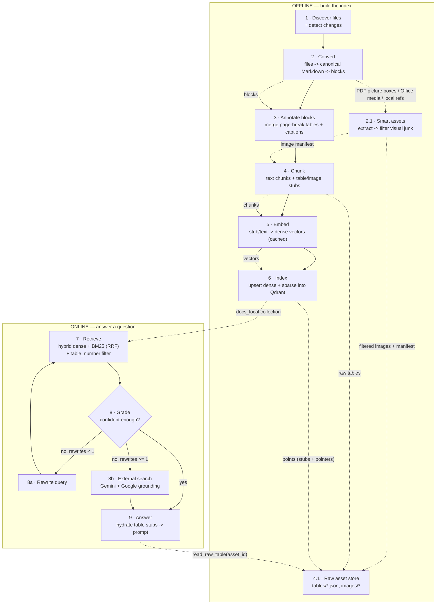
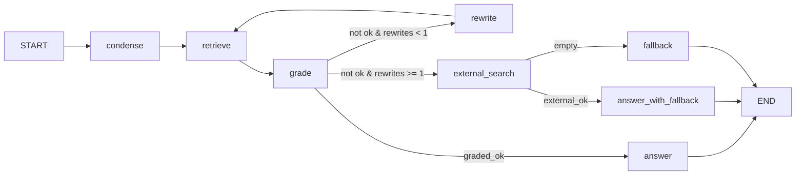

# DocIntel Agent — Pipeline

This document records **which stages the project runs and how each stage processes
data** — the transformations, decisions, and artifacts at every step. It is a
description of the pipeline, not a usage guide (setup and commands live in
`README.md`).

- Ingestion / indexing: `app/ingestion/folder.py`, `app/ingestion/extract.py`, `app/ingestion/assets.py`, `app/ingestion/chunking.py`, `app/ingestion/raw_assets.py`
- Retrieval: `app/retrieval/retrieve.py`, `app/retrieval/embeddings.py`, `app/retrieval/store.py`
- Reasoning: `app/reasoning/rag_graph.py`, `app/reasoning/answer.py`, `app/reasoning/table_tools.py`, `app/reasoning/image_tools.py`, `app/core/prompts.py`
- Evaluation: `app/evaluation/run_eval.py`, `app/evaluation/answer_eval.py`

---

## 0. The stages at a glance



Data moves through the stages as a chain of representations:

```
files ─► canonical Markdown ─► blocks ─► annotated blocks ─► chunks (text + table_stub + image_stub) ─► Qdrant points
      └─► smart assets ─► filtered images + manifest ─► data/index/assets/images/<file_id>/
                          raw tables (from chunks) ─► data/index/assets/tables/<file_id>.json
question ─► standalone query ─► ranked chunks ─► hydrate table_stubs from raw JSON ─► prompt ─► answer
```

**Core idea — raw on disk, stub/pointer in the index.** Table bodies and image
pixels are **not** embedded. A compact `table_stub` / `image_stub` is embedded for
retrieval; the full content stays on disk and is reached by a deterministic
`asset_id` (and `asset_path`) at query time.

---

## 1. Discover files & detect changes

**Component:** `sync_folder()` in `app/ingestion/folder.py`.

**Processing**

1. `snapshot(root)` (`app/indexing/scanner.py`) walks `data/docs/` recursively and
   keeps files whose suffix is in `SUPPORTED_EXTENSIONS`; any path containing a
   hidden segment (`.something`) is skipped. Only **metadata** is collected
   (`rel_path`, `name`, `size`, `mtime_ns`) — file contents are not opened.
   ```python
   SUPPORTED_EXTENSIONS = {".md", ".markdown", ".txt", ".docx", ".pptx",
                           ".pdf", ".html", ".htm"}
   ```
2. Metadata is compared against the SQLite **file-state cache**
   (`data/index/metadata.sqlite3`, table `file_state`), which stores `size`,
   `mtime_ns`, `content_hash`, `status` and `index_version` per
   `(scope, rel_path)`.
3. Three sets are derived:
   - **changed** — new path, `size`/`mtime_ns` differs, previous status was
     `pending`/`error`, or `INDEX_VERSION` changed
   - **deleted** — cached but no longer on disk
   - **unchanged** — identical metadata, fully skipped (no hash, no read)
4. **Hash confirmation:** a file whose mtime/size changed is hashed with SHA-256.
   If the hash equals the cached one (e.g. `touch`), its metadata is refreshed and
   it is not re-chunked/re-embedded.
5. The cache is cleared (forcing a full re-index) when the collection was just
   rebuilt or `INDEX_VERSION` was bumped.

**Output:** the lists `changed` / `deleted` and the metadata snapshot. `file_state` is
the only change-detection state; the old JSON manifest is no longer written or read.

For real-time updates the **watcher** bypasses this scan entirely: it enqueues only
the changed paths into the debounced background worker (see `INDEXING.md`).

**Design point:** change detection is **path-based**. A file's identity is
`file_id = md5(relative_path)`, so a rename is seen as delete + add.

---

## 2. Convert every document to canonical Markdown

**Component:** `canonical_markdown()` + `extract_blocks()` in `app/ingestion/extract.py`.

**Processing**

Every supported file is first converted to **one canonical Markdown string**, then a
single Markdown parser turns that string into **ordered blocks**, so structure
(headings, paragraph breaks, table position) survives:

| Block | Shape |
| --- | --- |
| `heading` | `{"type": "heading", "level": int, "text": str}` |
| `text` | `{"type": "text", "text": str}` |
| `table` | `{"type": "table", "rows": [[str, ...], ...]}` |
| `picture` | `{"type": "picture", "text": str}` |

| Format | Canonical source | How it processes |
| --- | --- | --- |
| `.md` / `.markdown` | file text | Already canonical; read as-is. |
| `.html` / `.htm` | **MarkItDown** | BeautifulSoup first removes page boilerplate (`script`, `style`, `noscript`, `nav`, `footer`, `header`, `aside`), then MarkItDown converts the cleaned HTML to Markdown. |
| `.docx` / `.pptx` / `.txt` | **MarkItDown** | MarkItDown converts the document to Markdown (headings, lists, tables and slide titles are preserved). |
| `.pdf` | **pymupdf4llm** (PyMuPDF) | `pymupdf4llm.to_markdown()` renders the PDF to Markdown (inferring headings and tables). Text inside picture regions is emitted as `picture` blocks. |
| anything else | — | Rejected. The scanner never enqueues unsupported formats (standalone spreadsheets, images and source code are skipped). |

**Normalisation** (`_normalize_markdown`)

- Fenced code and PyMuPDF4LLM's `<!-- Start/End of picture text -->` markers are
  protected first. HTML comments outside code are then removed; comments inside
  code samples survive. The picture markers are kept because they identify
  picture regions.
- Image references (``) are removed from the body text; local image
  files are still captured separately as visual assets (§2.1). `<br>` becomes a space
  and `&nbsp;`/non-breaking spaces become normal spaces.
- Line endings, trailing whitespace and runs of 3+ blank lines are normalised.

**Markdown parsing** (`_blocks_from_markdown`)

- `#` lines become `heading` blocks (level = number of leading `#`).
- Pipe tables become `table` blocks; the `| --- |` alignment row is dropped.
- Fenced code blocks are kept as `text` (a `#` inside code is never a heading).
- Other text accumulates into paragraph blocks; picture markers become `picture`
  blocks.

**Output:** an ordered `list[dict]` of blocks per file.

---

## 2.1 Extract & filter visual assets (smart asset extraction)

**Component:** `extract_assets()` in `app/ingestion/assets.py`.

**Processing**

Every indexed file also passes through a visual-asset pass. Extraction differs by
container, but filtering is shared:

| Source | Candidate extraction |
| --- | --- |
| `.pdf` | `pymupdf4llm` layout marks picture regions (`class = "picture"`); `pymupdf` renders each region to PNG at `ASSET_PDF_DPI`. This captures vector charts and scanned pages, not just embedded raster xrefs. The nearest caption box is attached when present. |
| `.docx` | `zipfile` reads image parts referenced by `word/document.xml` (plus footnotes/endnotes). Header/footer logos and unused media are never candidates. DrawingML `wp:extent` gives the displayed size in inches. |
| `.pptx` | `zipfile` reads image parts referenced by `ppt/slides/slideN.xml`. Slide masters/layouts and template logos are excluded. DrawingML `a:ext` gives the displayed size in inches. |
| `.md` / `.markdown` / `.html` / `.htm` | `_markup_candidates()` resolves local image references (`` / ``) that point to a real file next to the document; remote and data-URI sources are ignored. |
| `.txt` | No embedded image assets; the pass is a no-op. |

**Filtering** — a candidate is rejected when any check fails:

- `tiny_file` — smaller than `ASSET_MIN_BYTES`.
- `too_small` / `too_small_area` — pixel dimensions or area below the minimum.
- `thin` — aspect ratio above `ASSET_MAX_ASPECT_RATIO` (rules, dividers, banners).
- `blank` — ink ratio below `ASSET_MIN_INK_RATIO` (uniform/blank blocks).
- `small_on_page` — displayed too small: PDF bbox in points, or Office DrawingML
  extent in inches. This is what removes most logos and icons.
- `repeated` — the same small image appears `ASSET_REPEAT_COUNT` or more times
  (template logo/watermark).
- `unsupported_format` — image format PyMuPDF cannot decode (e.g. EMF/WMF/SVG).

**Output:** `data/index/assets/images/<file_id>/` containing the kept images plus
`manifest.json` (asset paths, page/slide, pixel/display size, bbox, caption,
sha256, entropy and rejection counts). Each kept image is later turned into an
`image_stub` chunk (see §4). `remove_raw_assets()` deletes both this directory and
the file's table manifest when the document is deleted.

**Standalone CLI:** `python -m app.ingestion.assets --root data/docs`.

---

## 3. Annotate blocks (page-break merge + captions)

**Components:** `_merge_page_break_tables()` then `_attach_table_captions()` in
`app/ingestion/chunking.py` (`build_chunks_for_file` runs
`_attach_table_captions(_merge_page_break_tables(extract_blocks(path)))`).

**Processing**

1. **Page-break table merge** (`_merge_page_break_tables`): a table split across
   pages is a `table` followed by another `table` — possibly with a short page
   marker (`"2"`, `"Page 3"`, `"continued"`) between them. They are merged when
   the second table has **no author caption** and the **same column count** as
   the first. If the second table repeats the header row, that row is dropped.
2. **Caption resolution** (`_attach_table_captions`): for each `table` or
   `picture` block, `_adjacent_caption()` looks at the neighbouring text blocks
   (the one **below first**, then the one above) and matches authored captions
   with two regexes:
   ```
   TABLE_RE  = ^\s*\**\s*(table|bảng)\s*([A-Za-z]?\.?\d+(?:\.\d+)*[a-z]?)\s*[:.\-]
   FIGURE_RE = ^\s*\**\s*(figure|hình)\s*([A-Za-z]?\.?\d+(?:\.\d+)*[a-z]?)\s*[:.\-]
   ```
   A trailing `:` `.` or `-` is required, so a reference like "Table 3 shows" does not
   match; dotted numbers (2.1, A.1, 3.2a) are kept whole.
3. Decisions:
   - A **table** with a "Table N:" caption is annotated with `caption` + `table_number`.
   - A **picture** region is kept **only if** its caption says "Table N" (the region is
     actually a boxed table); it is promoted to a `table` block using its text as
     content (`rows=[]`, `content=<text>`). Figure/chart text regions are **dropped** —
     real figures are captured separately as image assets (§2.1) and indexed as
     `image_stub` chunks (§4).
   - The caption block is marked consumed so it is not duplicated in the body.

**Output:** a new block list where page-split tables are merged and tables carry
captions.

---

## 4. Chunk blocks (text + table/image stubs)

**Component:** `build_chunks_for_file()` in `app/ingestion/chunking.py`; raw table
storage in `app/ingestion/raw_assets.py`.

**Processing**

The chunker walks the annotated blocks and tracks the **current heading** (initially
`"Overview"`):

| Incoming block | Processing |
| --- | --- |
| `heading` | Flush the body buffered under the previous heading (`emit_body()`), then push a node on the heading stack. The node gets a **materialized path id** (`s4`, `s4.1`, …; structural fallbacks `x1`/`s4.x1`), a clean title, a parsed section number and a depth. A heading is **never emitted as a chunk by itself** — it becomes the `section_id`/`section_ancestors` (and a clean text prefix) of the chunks that follow. |
| `text` / `picture` | Appended to a running `body` buffer. |
| `table` | Flush the body, then emit **one atomic `table_stub` chunk** (never split) and append a pointer line to the prose. See below. |

### 4.1 Table stub + raw store

For each table the chunker:

1. Computes a deterministic id `table_id = "{file_id}_{section_id}_t{index}"`.
2. Extracts `headers = rows[0]` and `row_keys` = first-column labels of the body
   rows (capped at `MAX_ROW_KEYS = 40`).
3. Emits a compact **`table_stub`** chunk whose text is:
   ```
   [TABLE STUB | ID: <table_id>]
   Caption: <author caption, else table_caption(rows)>
   Columns: <comma list of headers>
   Row Entities: <comma list of row_keys>
   Total Rows: <N>
   ```
   The **data rows themselves are not embedded** — only this semantic summary.
4. Appends a reference line `[Ref Table: <table_id> - <caption>]` to the running
   body, so prose and table stay linked.
5. Appends the **full raw table** (`headers`, `rows`, `content`, `caption`,
   `table_number`, `section_id`, `breadcrumb`, counts) to the file's table
   manifest, written to `data/index/assets/tables/<file_id>.json`.

A picture region promoted to a table (`rows=[]`, `content=<text>`) keeps its
extracted text in the stub (there are no columns/rows to summarize) and stores
`content` in the manifest; `read_raw_table` returns no rows for it and callers
fall back to the stub text.

### 4.2 Image stub + pointer

After the block walk, the kept images from `extract_assets()` become **`image_stub`**
chunks (no VLM call at ingest):

1. Deterministic id `image_id = "{file_id}_s0_p{index}"` (bound to the `Overview`
   section, since the asset manifest carries no section mapping).
2. Stub text:
   ```
   [IMAGE STUB | ID: <image_id> | Path: <asset_path>]
   Caption: <caption, when present>
   ```
3. A reference line `[Ref Image: <image_id> - <caption>]` is appended to the body.

### 4.3 Text splitting

`emit_body()` joins the buffered text and splits it with
`_split_text(text, CHUNK_TARGET_CHARS=1200, CHUNK_MAX_CHARS=1800)`:

- Paragraphs (split on blank lines) are greedily packed up to 1200 chars.
- Any single paragraph longer than 1800 chars is hard-split at fixed intervals.

Every emitted piece becomes a chunk record built by `_chunk_record`:

```python
header   = f"[Document: {file_name} | Section: {breadcrumb}]"  # clean, max 3 levels
text     = f"{header}\n\n{part}".strip()                         # self-describing prefix
chunk_id = f"{file_id}:{seq}"                                   # seq is per-file and monotonic
```

Fields: `chunk_id, file_id, path, url, title, file_name, section_heading, section_level,
section_depth, breadcrumbs, breadcrumb_levels, section_id, section_ancestors,
section_titles, section_depths, section_numbers, section_title_clean, section_number,
raw_heading, chunk_type, context_header, doc_type, char_count, text`. Stub chunks add
`asset_id`, `asset_path`, `caption`, `headers`, `row_count` (and `table_number` for
tables).

**Resulting rules**

- A table is always exactly one `table_stub` chunk; a text run is ≥1 chunk depending on length.
- A heading with no body produces no chunk of its own, but its node still appears in the
  canonical tree when any descendant chunk carries it in `section_ancestors`.
- `section_id` keeps the printed section path when consistent (`s4`, `s4.1`) and
  falls back to a structural id (`x1`, `s4.x1`) for unnumbered/wrapped headings; duplicate
  printed paths get a `-2` suffix, so every id is unique.
- A table stub shares its section's `section_id`; asking for that section returns prose **and**
  table stubs.
- The contextual header uses clean titles (no `**`, no synthetic `(Table)` suffix).

**Output:** `list[dict]` of chunk records for the changed files, plus
`data/index/assets/tables/<file_id>.json` (raw tables) and the image files/manifest
written in §2.1.

---

## 5. Embed chunks (with cache)

**Components:** `sync_folder` + `app/retrieval/embeddings.py`.

**Processing**

1. Load the **dense embedding cache** `data/index/embeddings_cache.jsonl`, a
   `text → vector` memo scoped by model:
   ```json
   {"model": "qwen/qwen3-embedding-8b", "text": "...", "embedding": [ ... ]}
   ```
2. `pending = [c for c in chunks if c["text"] not in cache]` — only chunks whose exact
   text is **not** cached are sent to the provider.
3. `embed_texts()` batches the pending texts to the configured provider:
   - `EMBEDDING_PROVIDER=openrouter` → `OPENROUTER_EMBEDDING_MODEL`
   - `EMBEDDING_PROVIDER=gemini` → `EMBEDDING_MODEL`
   with retry/backoff (and per-minute pacing on the Gemini free tier).
4. New vectors are appended to the cache; unchanged text reuses its cached vector.

**Key property:** the cache carries **only `{model, text, embedding}`** — no chunk
metadata — because it is a pure memo for avoiding repeated embedding calls. Chunk type
and position come from the chunk record / Qdrant payload, not from the cache.

**Output:** a dense vector for every chunk (from cache or freshly embedded).

---

## 6. Index into Qdrant

**Components:** `_ensure_collection()`, the upsert loop in `sync_folder`.

**Processing**

1. `_ensure_collection()` guarantees the collection schema. It **recreates** the
   collection when `--reset` is set, when the dense vector name/dimension changed (new
   embedding model), or when the sparse vector is missing (upgrade to native hybrid).
   A recreation forces a full re-index.
2. Every chunk is written as a `PointStruct` with **two vectors**:
   ```python
   models.PointStruct(
       id=point_id_for(chunk["chunk_id"]),                 # uuid5(chunk_id) — stable
       vector={
           "dense": cache[chunk["text"]],                                   # semantic
           "bm25":  models.Document(text=chunk["text"], model="Qdrant/bm25"),  # sparse, IDF
       },
       payload={ chunk_id, file_id, path, url, title, file_name,
                 section_id, section_ancestors, section_titles, section_depths,
                 section_numbers, section_title_clean, section_number,
                 raw_heading, chunk_type, section_heading, section_level,
                 section_depth, breadcrumbs, breadcrumb_levels, context_header,
                 doc_type, char_count, text, caption, table_number,
                 asset_id, asset_path, headers, row_count },     # stub -> raw pointer
   )
   ```
   - The **sparse BM25 vector** is encoded client-side by Qdrant's FastEmbed; the
     collection applies **IDF** when scoring.
   - `point_id = uuid5(NAMESPACE_URL, chunk_id)` is deterministic, so re-runs overwrite
     the same point instead of duplicating.
   - `table_stub` / `image_stub` payloads carry `asset_id` (deterministic id),
     `asset_path` (`tables/<file_id>.json` or `images/<file_id>/<name>.png`),
     `caption`, `headers`, `row_count` — the pointer the online path uses to
     resolve the raw content.
3. Points are upserted in batches. Before re-chunking, all points of a changed/deleted
   file were already deleted by `file_id`, so nothing goes stale.
4. **Lifecycle / cleanup:** deleting a file (or re-indexing it) also calls
   `remove_raw_assets(rel_path)`, which removes both
   `data/index/assets/tables/<file_id>.json` and
   `data/index/assets/images/<file_id>/` — no orphaned assets remain.
5. The file-state cache (`metadata.sqlite3`) is rewritten with the new hashes and
   `INDEX_VERSION`.
6. **Cache maintenance:** if the cache has grown past
   `live_points * 1.5 + 200`, `prune_cache()` scrolls the collection, collects the
   live `text` values, and drops cache lines no longer referenced.

**Collection schema**

```python
vectors_config        = { "dense": VectorParams(size=4096, distance=COSINE) }
sparse_vectors_config = { "bm25":  SparseVectorParams(modifier=IDF) }
```

**Output:** the `docs_local` collection under `output/qdrant_db/`, plus the updated
metadata cache and embedding cache.

---

## 7. Retrieve (online)

**Component:** `app/retrieval/retrieve.py`.

**Processing**

- The query is embedded with the **same provider/model used for the corpus**
  (`embed_query`), and the BM25 query is encoded by Qdrant from the raw text.
- `dense_search()` — pure semantic search over the `dense` vector.
- `vector_search()` — native **hybrid**: a dense prefetch and a sparse BM25 prefetch
  (`prefetch_limit = max(top_k * 4, 20)`), fused by Qdrant with **Reciprocal Rank
  Fusion**. Because RRF returns a rank aggregate (not a calibrated similarity), a
  separate dense query is run to keep a real `semantic_score` for the grading gate.
- Each hit is normalised into a result dict: `score` (fused), `semantic_score`,
  `keyword_score`, `chunk_id`, `file_id`, `url`, `title`, `section_id`,
  `section_ancestors`, `section_titles`, `section_title_clean`, `chunk_type`,
  `section_heading`, `text`, `caption`, `table_number`, plus the stub pointers
  `asset_id`, `asset_path`, `headers`, `row_count`.
- `section_chunks(scope, path, section_ids, include_descendants=...)` is the structural
  reader: it filters `section_id` (exact leaf, used by small-to-big) or
  `section_ancestors` (parent → whole subtree) with `MatchAny(any=[…])`. Raw heading
  text is never used as a filter.
- `table_chunks(scope, table_numbers, paths=...)` is a **payload filter**, not a text
  search: it returns `table_stub` chunks whose `table_number` matches an explicit
  reference (case variants included, so "table a.1" matches "A.1"). This guarantees
  "Table N" reaches the answer even when its stub ranks poorly for the wording.

**Output:** a ranked list of chunks.

---

## 8. Reason over the query (LangGraph)

**Component:** `app/reasoning/rag_graph.py`; state in `app/core/models.py` (`RAGState`).

This is the corrective-RAG state machine:



| Stage | Processing |
| --- | --- |
| `condense` | If there is `chat_history`, rewrite the follow-up into a standalone query; otherwise pass it through unchanged (no LLM call). |
| `retrieve` | `vector_search` (hybrid RRF) at `DEFAULT_TOP_K = 5`. Explicit "Table N"/"Bảng N" references are detected first and their stubs locked in via `table_chunks` (payload filter). |
| `grade` | If the top `semantic_score >= 0.5`, accept all chunks and **skip the LLM**. Otherwise ask the utility model which chunk indices are relevant and keep only those. Sets `graded_ok`. |
| route | `graded_ok` → answer; else if `rewrite_count < 1` → rewrite; else → external search. |
| `rewrite` | One query rewrite, then loop back to `retrieve`. Increments `rewrite_count`. |
| `answer` | Section-expand, **hydrate table/image stubs**, run the bounded `read_raw_table` tool pass, then generate. |
| `external_search` | Gemini + Google Search grounding; collects grounded text and source URLs. |
| `answer_with_fallback` | Generate from internal + external context combined. |
| `fallback` | Decline cleanly when nothing is usable. |

**Table/image hydration (answer building)** — `_sources_for_answer()` in
`rag_graph.py` runs, in order:

1. `_expand_to_sections()` — small-to-big: pull the full section a chunk belongs to.
2. `hydrate_table_stubs()` (`table_tools.py`) — for each `table_stub`, call
   `read_raw_table(asset_id)`, render the raw rows as Markdown, and **append** it to
   the chunk text. Empty-row (picture-derived) tables and missing files fall back to
   the stub text. Large tables are truncated to `TABLE_MAX_ROWS` (40) / `TABLE_MAX_CHARS`
   (6000) with a pointer to the id.
3. `hydrate_image_stubs()` (`image_tools.py`) — annotate each `image_stub` with its
   stored file path and metadata (size, page, caption); pixels are not inlined.
4. `_fetch_requested_tables()` — a **bounded tool pass**: only when the turn involves
   tables, a utility model is shown the Document Card table manifest
   (`available_tables`) and the current context, and may request up to
   `TABLE_TOOL_MAX_TABLES` (3) ids it still needs. Each is fetched with
   `read_raw_table_tool` (id validated against `_TABLE_ID_RE`) and appended as a fresh
   `table_stub` chunk. This covers unretrieved tables and rows truncated inline.

`read_raw_table` is exposed as the tool schema `READ_RAW_TABLE_TOOL` (`table_id: str`)
and mirrored by the manifest prompt; `view_image` (`image_id`/`image_path`) closes the
same loop for images. The simple `answer_question()` path in `answer.py` also runs both
hydration steps, so non-graph callers see raw rows too.

Supporting processing:

- Prompts are centralised in `app/core/prompts.py` and filled with `__PLACEHOLDER__`
  tokens via `str.replace` (never `str.format`, to avoid clashing with literal JSON
  braces).
- Auxiliary calls (`condense`, `grade`, `rewrite`) run on the fast, non-reasoning
  `OPENROUTER_UTILITY_MODELS`; answers run on `OPENROUTER_GENERATION_MODELS`.
- `_ready_models()` / cooldown in `answer.py` skip models that recently failed.
- `clean_text()` sanitises query text (drops lone surrogates from non-UTF-8 mounts).
- Multi-turn context is kept by the CLI: history is appended after each successful
  answer, `:reset` clears it, and a declining answer is not added to history.

**Output:** the answer plus the source list (internal chunks ± external URLs).

---

## 9. Evaluate

Two independent evaluation stages measure different layers.

### 9.1 Retrieval-level — `app/evaluation/run_eval.py`

**Processing**

- Runs each retriever (`dense` = `dense_search`, `hybrid` = `vector_search`) over the
  gold question set.
- Gold labels are defined by **(url, section_heading)** and **re-pointed** to the
  current corpus on every run, so chunker changes do not silently invalidate the data.
- Retrieves at `max(k)` once, then truncates the ranked list to compute metrics at each
  `k`: `hit@k`, `recall@k`, `precision@k`, `MRR@k`, plus mean latency.
- Retrieved id lists are cached so re-scoring does not re-query.

### 9.2 Answer-level — `app/evaluation/answer_eval.py`

**Processing**

- Generates one answer per gold question via `run_rag()`, checkpointing answers after
  each question.
- An **LLM-as-judge** (a model distinct from the generation chain, to reduce
  self-preference bias) scores each answer 1–5 on **faithfulness**,
  **answer_relevance**, and **citation_accuracy**.
- The judge response is parsed tolerantly (flat or nested JSON, code fences); a
  malformed response skips that question rather than crashing.

---

## 10. What each stage reads and writes

| Stage | Reads | Writes / produces |
| --- | --- | --- |
| 1 Discover | `data/docs/**`, `data/index/metadata.sqlite3` | `changed` / `deleted` sets |
| 2 Extract | file bytes | canonical Markdown -> ordered blocks |
| 2.1 Assets | file bytes (PDF picture boxes, Office media, local image refs) | filtered images + `data/index/assets/images/<file_id>/manifest.json` |
| 3 Annotate | blocks | merged tables + annotated blocks (captions, picture promotion) |
| 4 Chunk | annotated blocks, image manifest | chunk records; raw tables -> `data/index/assets/tables/<file_id>.json` |
| 5 Embed | chunk text (stub text included), `embeddings_cache.jsonl` | dense vectors, updated cache |
| 6 Index | vectors + chunk records | `output/qdrant_db/` (`docs_local`), `metadata.sqlite3`; deletes stale raw assets |
| Cache prune | Qdrant payloads, cache | trimmed cache |
| 7 Retrieve | query, `docs_local`, Document Cards | ranked chunks (incl. raw-table JSON via `read_raw_table`) |
| 8 Reason | ranked chunks, raw tables/images, chat history, web | answer + sources |
| 9 Eval | questions, retrievers, `run_rag` | `output/eval_report.json`, `output/answer_eval/*.json` |

---

## 11. Invariants the pipeline relies on

- **Identity is path-based.** `file_id = md5(relative_path)`, so renaming a file means
  deleting the old points and adding new ones.
- **Chunk text contains `title` + `heading`.** Renaming a file or changing a heading
  changes the chunk text, which invalidates the cache entries for that file.
- **Raw on disk, stub/pointer in the index.** Table rows and image pixels are never
  embedded. A `table_stub`/`image_stub` carries only a semantic summary plus an
  `asset_id`/`asset_path` pointer; the full data lives in `data/index/assets/` and is
  fetched by id at query time.
- **Table/image ids are deterministic.** `table_id = "<file_id>_<section_id>_t<i>"`,
  `image_id = "<file_id>_s0_p<i>"`; re-indexing the same file yields the same ids, so
  pointers and manifests stay consistent.
- **A table is one atomic `table_stub`.** Tables are never split; page-split tables are
  merged at ingestion, and the authored "Table N" caption is the primary retrieval
  signal (the stub embeds columns + row entities, not the data rows).
- **Pictures are only promoted when captioned "Table N".** Figure/chart picture text is
  dropped from the body; real figures are indexed separately as image stubs.
- **Only informative images are stored as assets.** Tiny, thin, blank, repeated or
  unsupported images never reach `data/index/assets/`; asset extraction failure
  must never block text indexing.
- **The embedding cache is not a chunk store.** It holds no metadata; chunk type is read
  from the Qdrant payload (`table_stub`/`image_stub`, plus `asset_id`, `caption`,
  `table_number`).
- **Retrieval uses payload metadata, not text matching, for references.** "Table N" uses
  a `table_number` filter (`table_chunks`); hydration uses `asset_id`, never a path
  guess.
- **Sections are identified by materialized paths, not heading text.** `section_id`
  (`s4.1`; `x`/`-2` fallbacks for unnumbered or duplicate paths) and
  `section_ancestors` are generated at ingestion; `MatchAny` on `section_ancestors`
  returns a parent's whole subtree. `section_heading` is display / evaluation metadata
  only and must never be used as a retrieval filter.
- **The Document Card is the outline source of truth.** `outline_tree`, `tables` and
  `images` are refreshed by `POST /api/sync`; chat reads them from the RAM-cached
  registry and does not scroll Qdrant to build an outline or table manifest.
- **`INDEX_VERSION` is the re-index switch.** Bump it whenever extraction/chunking
  changes, to force a full re-index without a manual reset. (Currently `"15"`;
  `outline_version` `3`.)
