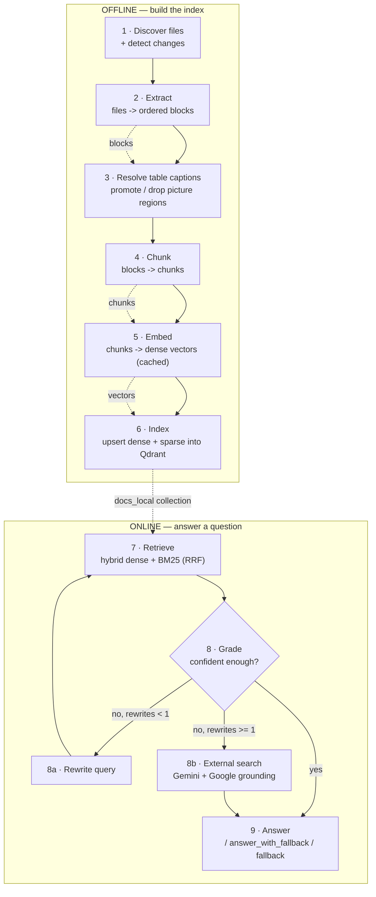
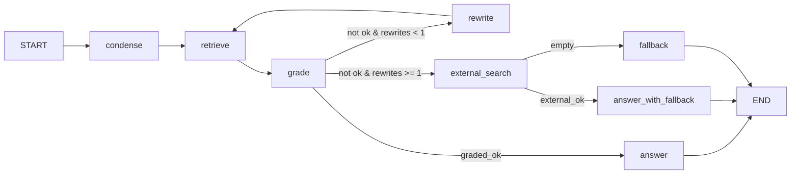

# DocIntel Agent — Pipeline

This document records **which stages the project runs and how each stage processes
data** — the transformations, decisions, and artifacts at every step. It is a
description of the pipeline, not a usage guide (setup and commands live in
`README.md`).

- Ingestion / indexing: `app/ingestion/folder.py`, `app/ingestion/extract.py`
- Retrieval: `app/retrieval/retrieve.py`, `app/retrieval/embeddings.py`, `app/retrieval/store.py`
- Reasoning: `app/reasoning/rag_graph.py`, `app/reasoning/answer.py`, `app/core/prompts.py`
- Evaluation: `app/evaluation/run_eval.py`, `app/evaluation/answer_eval.py`

---

## 0. The stages at a glance



Data moves through the stages as a chain of representations:

```
files ─► blocks ─► annotated blocks ─► chunks ─► (text, dense vector, sparse vector) ─► Qdrant points
question ─► standalone query ─► ranked chunks ─► (relevant chunks ± web context) ─► answer
```

---

## 1. Discover files & detect changes

**Component:** `sync_folder()` in `app/ingestion/folder.py`.

**Processing**

1. `snapshot(root)` (`app/indexing/scanner.py`) walks `data/docs/` recursively and
   keeps files whose suffix is in `SUPPORTED_EXTENSIONS`; any path containing a
   hidden segment (`.something`) is skipped. Only **metadata** is collected
   (`rel_path`, `name`, `size`, `mtime_ns`) — file contents are not opened.
   ```python
   SUPPORTED_EXTENSIONS = {".md", ".markdown", ".txt", ".py", ".json",
                           ".docx", ".pdf", ".html", ".htm"}
   ```
2. Metadata is compared against the SQLite **file-state cache**
   (`data/index/metadata.sqlite3`, table `file_state`), which stores `size`,
   `mtime_ns`, `content_hash`, `status` and `index_version` per
   `(scope, rel_path)`.
3. Three sets are derived:
   - **changed** — new path, `size`/`mtime_ns` differs, previous status was
     `pending`/`error`, or `INDEX_VERSION` changed
   - **deleted** — cached but no longer on disk
   - **unchanged** — identical metadata, fully skipped (no hash, no read)
4. **Hash confirmation:** a file whose mtime/size changed is hashed with SHA-256.
   If the hash equals the cached one (e.g. `touch`), its metadata is refreshed and
   it is not re-chunked/re-embedded.
5. The cache is cleared (forcing a full re-index) when the collection was just
   rebuilt or `INDEX_VERSION` was bumped.

**Output:** the lists `changed` / `deleted` and the metadata snapshot. `file_state` is
the only change-detection state; the old JSON manifest is no longer written or read.

For real-time updates the **watcher** bypasses this scan entirely: it enqueues only
the changed paths into the debounced background worker (see `INDEXING.md`).

**Design point:** change detection is **path-based**. A file's identity is
`file_id = md5(relative_path)`, so a rename is seen as delete + add.

---

## 2. Extract files into ordered blocks

**Component:** `extract_blocks()` in `app/ingestion/extract.py`.

**Processing**

Instead of flattening a file to one string, each file is converted into a list of
**ordered blocks**, so structure (headings, paragraph breaks, table position) survives.

| Block | Shape |
| --- | --- |
| `heading` | `{"type": "heading", "level": int, "text": str}` |
| `text` | `{"type": "text", "text": str}` |
| `table` | `{"type": "table", "rows": [[str, ...], ...]}` |
| `picture` | `{"type": "picture", "text": str}` |

Each format has its own extractor:

| Format | Extractor | How it processes |
| --- | --- | --- |
| `.md` / `.markdown` | `_blocks_from_markdown` | Streaming parse: plain lines buffer into a paragraph; a blank line, `#` heading, or `|` table row flushes it. Headings become `heading` blocks (level = count of leading `#`); pipe tables are parsed by `_parse_markdown_table`, which drops the `| --- |` alignment row via `_is_separator`. |
| `.docx` | `_blocks_docx` | `document.iter_inner_content()` preserves true order; paragraphs with Word heading/title styles become `heading` blocks, other paragraphs become `text`, and `Table` objects become `table` blocks (cell text stripped, all-empty rows dropped). |
| `.pdf` | `_blocks_pdf` | `pymupdf4llm.to_markdown()` renders the PDF to Markdown (inferring headings and tables), then the Markdown parser runs over it. Text inside picture regions is emitted as `picture` blocks. |
| `.html` / `.htm` | `_blocks_html` | BeautifulSoup strips `script/style/noscript/nav/footer/header/aside`; then `h*`, `p`, `li`, and `table` elements become heading/text/table blocks. |
| everything else | `_blocks_text` | The whole file (`.txt`, code, JSON, ...) becomes a single `text` block. |

**Output:** an ordered `list[dict]` of blocks per file.

---

## 3. Resolve table captions & filter figures

**Component:** `_attach_table_captions()` in `app/ingestion/folder.py`.

**Processing**

1. For each `table` or `picture` block, `_adjacent_caption()` looks at the neighbouring
   text blocks (the one **below first**, then the one above) and matches authored
   captions with two regexes:
   ```
   TABLE_RE  = ^\s*\**\s*(table|bảng)\s*([A-Za-z]?\.?\d+(?:\.\d+)*[a-z]?)\s*[:.\-]
   FIGURE_RE = ^\s*\**\s*(figure|hình)\s*([A-Za-z]?\.?\d+(?:\.\d+)*[a-z]?)\s*[:.\-]
   ```
   A trailing `:` `.` or `-` is required, so a reference like "Table 3 shows" does not
   match; dotted numbers (2.1, A.1, 3.2a) are kept whole.
2. Decisions:
   - A **table** with a "Table N:" caption is annotated with `caption` + `table_number`.
   - A **picture** region is kept **only if** its caption says "Table N" (the region is
     actually a boxed table); it is promoted to a `table` block using its text as
     content. Figure/chart regions are **dropped** (their text is meaningless without
     the image).
   - The caption block is marked consumed so it is not duplicated in the body.

**Output:** a new block list where tables carry captions and figure text is removed.

---

## 4. Chunk blocks

**Component:** `build_chunks_for_file()` in `app/ingestion/folder.py`.

**Processing**

The chunker walks the annotated blocks and tracks the **current heading** (initially
`"Overview"`):

| Incoming block | Processing |
| --- | --- |
| `heading` | Flush the body buffered under the previous heading (`emit_body()`), then push a node on the heading stack. The node gets a **materialized path id** (`s4`, `s4.1`, …; structural fallbacks `x1`/`s4.x1`), a clean title, a parsed section number and a depth. A heading is **never emitted as a chunk by itself** — it becomes the `section_id`/`section_ancestors` (and a clean text prefix) of the chunks that follow. |
| `text` / `picture` | Appended to a running `body` buffer. |
| `table` | Flush the body, then emit **one atomic chunk** that is never split. Caption (author caption, else `table_caption(rows)`) is the primary signal; the nearest heading is fallback context only when no author caption exists. The table shares its section's `section_id`; only `chunk_type=table` and the display-only `section_heading` suffix `(Table)` differ. |

`emit_body()` joins the buffered text and splits it with
`_split_text(text, CHUNK_TARGET_CHARS=1200, CHUNK_MAX_CHARS=1800)`:

- Paragraphs (split on blank lines) are greedily packed up to 1200 chars.
- Any single paragraph longer than 1800 chars is hard-split at fixed intervals.

Every emitted piece becomes a chunk record built by `_chunk_record`:

```python
header   = f"[Document: {file_name} | Section: {breadcrumb}]"  # clean, max 3 levels
text     = f"{header}\n\n{part}".strip()                         # self-describing prefix
chunk_id = f"{file_id}:{seq}"                                   # seq is per-file and monotonic
```

Fields: `chunk_id, file_id, path, url, title, file_name, section_heading, section_level,
section_depth, breadcrumbs, breadcrumb_levels, section_id, section_ancestors,
section_titles, section_depths, section_numbers, section_title_clean, section_number,
raw_heading, chunk_type, context_header, doc_type, char_count, text` (plus `caption`,
`table_number` for tables).

**Resulting rules**

- A table is always exactly one chunk; a text run is ≥1 chunk depending on length.
- A heading with no body produces no chunk of its own, but its node still appears in the
  canonical tree when any descendant chunk carries it in `section_ancestors`.
- `section_id` keeps the printed section path when consistent (`s4`, `s4.1`) and
  falls back to a structural id (`x1`, `s4.x1`) for unnumbered/wrapped headings; duplicate
  printed paths get a `-2` suffix, so every id is unique.
- A table shares its section's `section_id`; asking for that section returns prose **and**
  table chunks.
- The contextual header uses clean titles (no `**`, no synthetic `(Table)` suffix).

**Output:** `list[dict]` of chunk records for the changed files.

---

## 5. Embed chunks (with cache)

**Components:** `sync_folder` + `app/retrieval/embeddings.py`.

**Processing**

1. Load the **dense embedding cache** `data/index/embeddings_cache.jsonl`, a
   `text → vector` memo scoped by model:
   ```json
   {"model": "qwen/qwen3-embedding-8b", "text": "...", "embedding": [ ... ]}
   ```
2. `pending = [c for c in chunks if c["text"] not in cache]` — only chunks whose exact
   text is **not** cached are sent to the provider.
3. `embed_texts()` batches the pending texts to the configured provider:
   - `EMBEDDING_PROVIDER=openrouter` → `OPENROUTER_EMBEDDING_MODEL`
   - `EMBEDDING_PROVIDER=gemini` → `EMBEDDING_MODEL`
   with retry/backoff (and per-minute pacing on the Gemini free tier).
4. New vectors are appended to the cache; unchanged text reuses its cached vector.

**Key property:** the cache carries **only `{model, text, embedding}`** — no chunk
metadata — because it is a pure memo for avoiding repeated embedding calls. Chunk type
and position come from the chunk record / Qdrant payload, not from the cache.

**Output:** a dense vector for every chunk (from cache or freshly embedded).

---

## 6. Index into Qdrant

**Components:** `_ensure_collection()`, the upsert loop in `sync_folder`.

**Processing**

1. `_ensure_collection()` guarantees the collection schema. It **recreates** the
   collection when `--reset` is set, when the dense vector name/dimension changed (new
   embedding model), or when the sparse vector is missing (upgrade to native hybrid).
   A recreation forces a full re-index.
2. Every chunk is written as a `PointStruct` with **two vectors**:
   ```python
   models.PointStruct(
       id=point_id_for(chunk["chunk_id"]),                 # uuid5(chunk_id) — stable
       vector={
           "dense": cache[chunk["text"]],                                   # semantic
           "bm25":  models.Document(text=chunk["text"], model="Qdrant/bm25"),  # sparse, IDF
       },
       payload={ chunk_id, file_id, path, url, title, file_name,
                 section_id, section_ancestors, section_titles, section_depths,
                 section_numbers, section_title_clean, section_number,
                 raw_heading, chunk_type, section_heading, section_level,
                 section_depth, breadcrumbs, breadcrumb_levels, context_header,
                 doc_type, char_count, text, caption, table_number },
   )
   ```
   - The **sparse BM25 vector** is encoded client-side by Qdrant's FastEmbed; the
     collection applies **IDF** when scoring.
   - `point_id = uuid5(NAMESPACE_URL, chunk_id)` is deterministic, so re-runs overwrite
     the same point instead of duplicating.
3. Points are upserted in batches. Before re-chunking, all points of a changed/deleted
   file were already deleted by `file_id`, so nothing goes stale.
4. The file-state cache (`metadata.sqlite3`) is rewritten with the new hashes and
   `INDEX_VERSION`.
5. **Cache maintenance:** if the cache has grown past
   `live_points * 1.5 + 200`, `prune_cache()` scrolls the collection, collects the
   live `text` values, and drops cache lines no longer referenced.

**Collection schema**

```python
vectors_config        = { "dense": VectorParams(size=4096, distance=COSINE) }
sparse_vectors_config = { "bm25":  SparseVectorParams(modifier=IDF) }
```

**Output:** the `docs_local` collection under `output/qdrant_db/`, plus the updated
metadata cache and embedding cache.

---

## 7. Retrieve (online)

**Component:** `app/retrieval/retrieve.py`.

**Processing**

- The query is embedded with the **same provider/model used for the corpus**
  (`embed_query`), and the BM25 query is encoded by Qdrant from the raw text.
- `dense_search()` — pure semantic search over the `dense` vector.
- `vector_search()` — native **hybrid**: a dense prefetch and a sparse BM25 prefetch
  (`prefetch_limit = max(top_k * 4, 20)`), fused by Qdrant with **Reciprocal Rank
  Fusion**. Because RRF returns a rank aggregate (not a calibrated similarity), a
  separate dense query is run to keep a real `semantic_score` for the grading gate.
- Each hit is normalised into a result dict: `score` (fused), `semantic_score`,
  `keyword_score`, `chunk_id`, `file_id`, `url`, `title`, `section_id`,
  `section_ancestors`, `section_titles`, `section_title_clean`, `chunk_type`,
  `section_heading`, `text`, `caption`, `table_number`.
- `section_chunks(scope, path, section_ids, include_descendants=...)` is the structural
  reader: it filters `section_id` (exact leaf, used by small-to-big) or
  `section_ancestors` (parent → whole subtree) with `MatchAny(any=[…])`. Raw heading
  text is never used as a filter.

**Output:** a ranked list of chunks.

---

## 8. Reason over the query (LangGraph)

**Component:** `app/reasoning/rag_graph.py`; state in `app/core/models.py` (`RAGState`).

This is the corrective-RAG state machine:



| Stage | Processing |
| --- | --- |
| `condense` | If there is `chat_history`, rewrite the follow-up into a standalone query; otherwise pass it through unchanged (no LLM call). |
| `retrieve` | `vector_search` (hybrid RRF) at `DEFAULT_TOP_K = 5`. |
| `grade` | If the top `semantic_score >= 0.5`, accept all chunks and **skip the LLM**. Otherwise ask the utility model which chunk indices are relevant and keep only those. Sets `graded_ok`. |
| route | `graded_ok` → answer; else if `rewrite_count < 1` → rewrite; else → external search. |
| `rewrite` | One query rewrite, then loop back to `retrieve`. Increments `rewrite_count`. |
| `answer` | Generate from the relevant internal chunks only. |
| `external_search` | Gemini + Google Search grounding; collects grounded text and source URLs. |
| `answer_with_fallback` | Generate from internal + external context combined. |
| `fallback` | Decline cleanly when nothing is usable. |

Supporting processing:

- Prompts are centralised in `app/core/prompts.py` and filled with `__PLACEHOLDER__`
  tokens via `str.replace` (never `str.format`, to avoid clashing with literal JSON
  braces).
- Auxiliary calls (`condense`, `grade`, `rewrite`) run on the fast, non-reasoning
  `OPENROUTER_UTILITY_MODELS`; answers run on `OPENROUTER_GENERATION_MODELS`.
- `_ready_models()` / cooldown in `answer.py` skip models that recently failed.
- `clean_text()` sanitises query text (drops lone surrogates from non-UTF-8 mounts).
- Multi-turn context is kept by the CLI: history is appended after each successful
  answer, `:reset` clears it, and a declining answer is not added to history.

**Output:** the answer plus the source list (internal chunks ± external URLs).

---

## 9. Evaluate

Two independent evaluation stages measure different layers.

### 9.1 Retrieval-level — `app/evaluation/run_eval.py`

**Processing**

- Runs each retriever (`dense` = `dense_search`, `hybrid` = `vector_search`) over the
  gold question set.
- Gold labels are defined by **(url, section_heading)** and **re-pointed** to the
  current corpus on every run, so chunker changes do not silently invalidate the data.
- Retrieves at `max(k)` once, then truncates the ranked list to compute metrics at each
  `k`: `hit@k`, `recall@k`, `precision@k`, `MRR@k`, plus mean latency.
- Retrieved id lists are cached so re-scoring does not re-query.

### 9.2 Answer-level — `app/evaluation/answer_eval.py`

**Processing**

- Generates one answer per gold question via `run_rag()`, checkpointing answers after
  each question.
- An **LLM-as-judge** (a model distinct from the generation chain, to reduce
  self-preference bias) scores each answer 1–5 on **faithfulness**,
  **answer_relevance**, and **citation_accuracy**.
- The judge response is parsed tolerantly (flat or nested JSON, code fences); a
  malformed response skips that question rather than crashing.

---

## 10. What each stage reads and writes

| Stage | Reads | Writes / produces |
| --- | --- | --- |
| 1 Discover | `data/docs/**`, `data/index/metadata.sqlite3` | `changed` / `deleted` sets |
| 2 Extract | file bytes | ordered blocks |
| 3 Captions | blocks | annotated blocks (captions, figure filtering) |
| 4 Chunk | annotated blocks | chunk records |
| 5 Embed | chunk text, `embeddings_cache.jsonl` | dense vectors, updated cache |
| 6 Index | vectors + chunk records | `output/qdrant_db/` (`docs_local`), `metadata.sqlite3` |
| Cache prune | Qdrant payloads, cache | trimmed cache |
| 7 Retrieve | query, `docs_local` | ranked chunks |
| 8 Reason | ranked chunks, chat history, web | answer + sources |
| 9 Eval | questions, retrievers, `run_rag` | `output/eval_report.json`, `output/answer_eval/*.json` |

---

## 11. Invariants the pipeline relies on

- **Identity is path-based.** `file_id = md5(relative_path)`, so renaming a file means
  deleting the old points and adding new ones.
- **Chunk text contains `title` + `heading`.** Renaming a file or changing a heading
  changes the chunk text, which invalidates the cache entries for that file.
- **A table is atomic and caption-first.** Tables are never split; the authored caption
  is preferred over the surrounding heading as retrieval context.
- **Picture regions are dropped unless a "Table N" caption promotes them.**
- **The embedding cache is not a chunk store.** It holds no metadata; chunk type is read
  from the Qdrant payload (`chunk_type == "table"`, plus `caption` / `table_number`).
- **Sections are identified by materialized paths, not heading text.** `section_id`
  (`s4.1`; `x`/`-2` fallbacks for unnumbered or duplicate paths) and
  `section_ancestors` are generated at ingestion; `MatchAny` on `section_ancestors`
  returns a parent's whole subtree. `section_heading` is display / evaluation metadata
  only and must never be used as a retrieval filter.
- **The Document Card is the outline source of truth.** `outline_tree` is refreshed by
  `POST /api/sync`; chat reads it from the RAM-cached registry and does not scroll Qdrant
  to build an outline.
- **`INDEX_VERSION` is the re-index switch.** Bump it whenever extraction/chunking
  changes, to force a full re-index without a manual reset.
